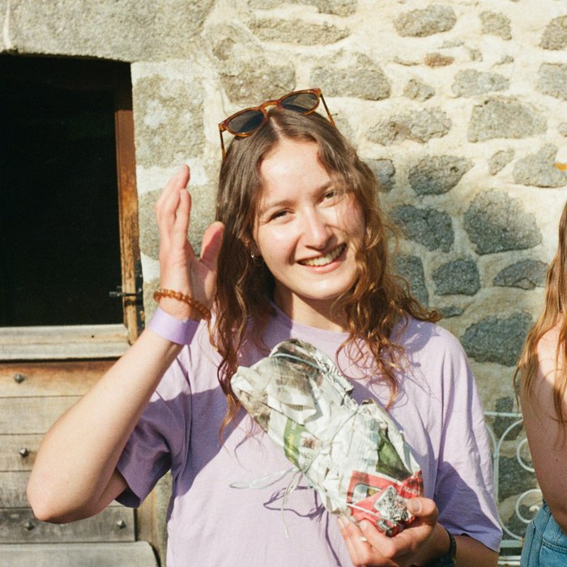

<!--
  PAGE D'ACCUEIL : mode d'emploi
  Trois blocs (styles dans styles.css, section 9) :
  1. <header class="hero"> : grand bloc vert (nom, rôle, boutons, photo).
     Le nom est un <p> déclaré comme titre de niveau 1 (role="heading") et
     non un vrai <h1> : les styles de titres du thème le rendaient invisible.
     Les boutons sont des liens <a> ; les icônes viennent de Bootstrap Icons
     (nom à chercher sur icons.getbootstrap.com : <i class="bi bi-NOM">).
     Photo : images/profil_image.jpg (changer le nom du fichier si besoin).
  2. ::: lead : paragraphe d'introduction en plus grand.
  3. <nav class="explore"> : tuiles de navigation. Chaque tuile est un lien
     <a class="tile" href="page.html"> avec <b> pour le titre et <span> pour
     la description. Les liens finissent en .html (et non .qmd) car ce
     bloc est écrit en HTML brut. Couleurs dans l'ordre : vert, teal, ocre,
     terre cuite, brun terre (5 tuiles ; une 6e demande une règle CSS,
     voir styles.css section 9).
  Cette page n'a pas de « title » : pas de bandeau automatique, le bloc
  « hero » en tient lieu.
-->

```{=html}
<header class="hero">
  <div>
    <p class="hero-name" role="heading" aria-level="1">Emma Belaud</p>
    <p class="hero-role">Chercheuse en écologie des sols</p>
    <div class="hero-links">
      <a href="https://github.com/emmabelaud"><i class="bi bi-github"></i> GitHub</a>
      <a href="https://www.researchgate.net/profile/Emma-Belaud"><i class="bi bi-mortarboard"></i> ResearchGate</a>
      <a href="https://orcid.org/0009-0003-8023-5140"><i class="bi bi-person-badge"></i> ORCID</a>
    </div>
  </div>
  
</header>
```

::: lead
Je travaille en **écologie des sols**, avec un intérêt particulier pour le développement de **méthodes de suivi par capteurs**. J'ai récemment soutenu ma thèse, intitulée *« Soil ecology in the digital age: challenges and contributions of automated edaphic biodiversity monitoring »*. Dans ce cadre, j'ai contribué au développement d'une nouvelle méthode d'imagerie *in situ* du sol, qui permet de suivre de façon non invasive et dynamique l'activité des racines et des invertébrés du sol. J'ai exploré ce que cette méthode pouvait révéler de l'organisation spatio-temporelle de l'activité du sol, à différentes échelles écologiques, spatiales et temporelles.
:::

```{=html}
<nav class="explore">
  <a class="tile" href="soil_biodiversity_imaging.html"><b>Imagerie de la biodiversité du sol</b><span>Observer la vie du sol <em>in situ</em> et en continu, grâce à des scanners enterrés automatisés</span></a>
  <a class="tile" href="soil_organisms.html"><b>À la rencontre des organismes du sol</b><span>Les organismes qui vivent sous nos pieds et ce qu'ils font, rendus visibles par l'imagerie</span></a>
  <a class="tile" href="publications.html"><b>Publications</b><span>Articles publiés et manuscrits en cours</span></a>
  <a class="tile" href="resources.html"><b>Ressources</b><span>Vidéos, données et présentations mettant en avant ce que les scanners enterrés révèlent de la vie du sol</span></a>
  <a class="tile" href="cv.html"><b>CV</b><span>Formation, expérience en recherche, encadrement, communication scientifique et vulgarisation</span></a>
</nav>
```
