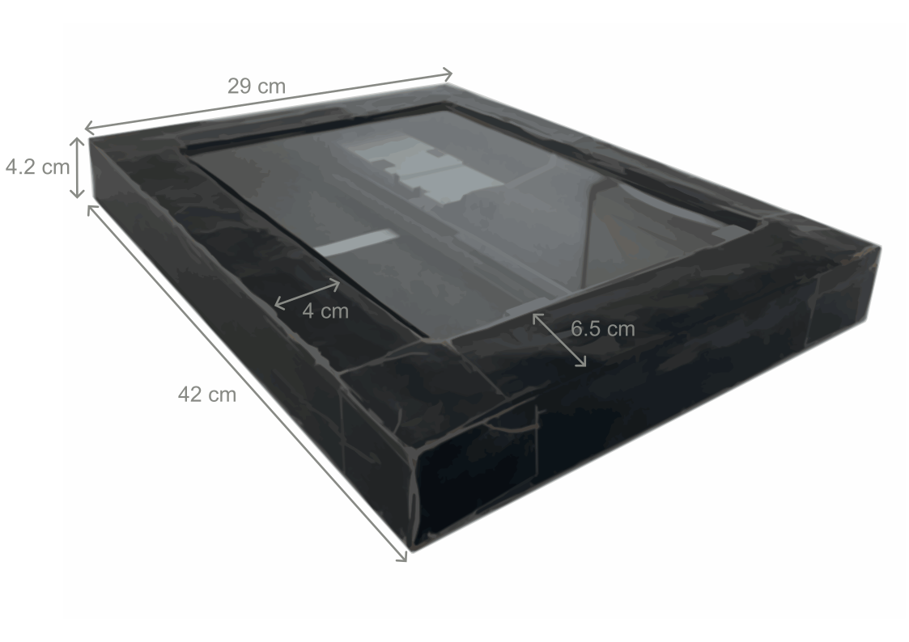
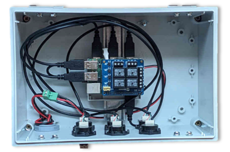
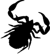

## Contexte

Le sol est un immense réservoir de biodiversité : il abrite plus d'un quart de toutes les espèces terrestres (pour en savoir plus, voir la page [organismes du sol](soil_organisms.qmd)). Pourtant, son opacité et le caractère discret des organismes qui y vivent en font un milieu particulièrement difficile à étudier. Pour relever ce défi, nous avons développé, à l'unité de recherche Eco&Sols, une **méthode innovante** de suivi de l'activité biologique du sol *in situ* par imagerie.

## Le dispositif

Le système repose sur des scanners à plat de bureau, adaptés aux conditions de terrain et enterrés dans le sol. Sur le terrain, chaque scanner est associé à un module de contrôle automatisé basé sur un Raspberry Pi, qui pilote l'acquisition des images. Ce montage permet de mener des campagnes d'acquisition à haute résolution sur le long terme, avec un minimum d'intervention humaine.

::: {layout-ncol=2}



:::

:::: key-facts

::: fact
[6 h]{.fact-value}
[entre deux images]{.fact-label}
:::

::: fact
[1200 dpi]{.fact-value}
[résolution des images]{.fact-label}
:::

::: fact
[A4]{.fact-value}
[surface scannée]{.fact-label}
:::

::: fact
[> 1 mm]{.fact-value}
[taille des organismes suivis]{.fact-label}
:::

::::

## Ce que révèlent les images

Les images sont acquises en routine toutes les six heures, à 1200 dpi, sur une surface A4. Cela permet de suivre l'activité des organismes de plus d'un millimètre, notamment les structures racinaires, certaines structures fongiques et de nombreux taxons d'invertébrés, et d'observer leur dynamique à fine échelle temporelle sur de longues périodes. Des exemples de photos et de vidéos de ce qu'il est possible d'observer sont disponibles sur la page [organismes du sol](soil_organisms.qmd).

## Des images aux données

Le suivi automatisé à haute fréquence génère un volume de données qui rend rapidement impossible l'analyse manuelle par des experts, compte tenu des ressources humaines et du temps disponibles. Généraliser les approches par imagerie et, plus largement, évoluer vers une écologie du sol à grande échelle nécessite donc des chaînes d'analyse automatisées, capables de traiter de grands flux d'images avec une précision comparable à celle d'un expert humain. Nous travaillons à la conception de telles chaînes.

:::: card-grid

::: {.card-block .pipeline-card}
[]{.card-icon .card-icon-img}

### Structures racinaires

Pour extraire des informations biologiques sur les structures racinaires, nous utilisons **RootPainter**, un outil basé sur l'apprentissage profond développé à l'Université de Copenhague. Le modèle nécessite une phase d'entraînement ; une fois entraîné, l'outil s'est révélé très efficace pour segmenter les structures racinaires dans nos images.

[Publication associée ](https://doi.org/10.1111/nph.18387){.accent-link}

```{=html}
<video class="pipeline-video" controls playsinline preload="metadata" poster="../images/posters/rootpainter_annotation.jpg">
  <source src="../images/rootpainter_annotation.mp4" type="video/mp4">
</video>
```

L'interface d'annotation de RootPainter.
:::

::: {.card-block .pipeline-card}
[]{.card-icon .card-icon-img}

### Invertébrés du sol

Pour les invertébrés, nous développons actuellement notre propre outil, qui fonctionne en deux étapes : la **détection** des animaux, par des méthodes heuristiques comparant des images successives, puis leur **classification**, à l'aide d'un modèle d'apprentissage profond.

[Publication associée ](https://doi.org/10.64898/2026.06.16.732537){.accent-link}

```{=html}
<video class="pipeline-video" controls playsinline preload="metadata" poster="../images/posters/invertebrate_annotation.jpg">
  <source src="../images/invertebrate_annotation.mp4" type="video/mp4">
</video>
```

L'interface Shiny utilisée pour annoter les invertébrés et entraîner le modèle.
:::

::::

## Personnes impliquées

- Didier Arnal, technicien (retraité), CIRAD
- Philippe Gallet, ingénieur de recherche, CIRAD
- Mickael Hedde, directeur de recherche, INRAE
- Hadrien Hendrickx, chargé de recherche, INRIA
- Christophe Jourdan, directeur de recherche, CIRAD
- Guerric Le Maire, directeur de recherche, CIRAD
- François Postic, chercheur postdoctoral, CIRAD

## Publications associées

- Belaud, E., Jourdan, C., Capowiez, Y., Hedde, M. (2026). Hearing and seeing through the soils: insights from new sensing technologies to monitor soil invertebrate activity. *Plant and Soil*. [doi](https://doi.org/10.1007/s11104-026-08694-2)
- Belaud, E., Jourdan, C., Barry-Etienne, D., Marsden, C., Robin, A., Taschen, E., Hedde, M. (2024). In situ soil imaging, a tool for monitoring the hourly to monthly temporal dynamics of soil biota. *Biology and Fertility of Soils*, 60, 1055–1071. [doi](https://doi.org/10.1007/s00374-024-01851-8)
- Pruvost, E., et al. (2022). Invertebrates detection with YOLOv5: towards study of soil organisms using deep learning. *IEEE*. [doi](http://dx.doi.org/10.1109/EUVIP53989.2022.9922675)

Retrouvez la liste complète sur la page [Publications](publications.qmd), et d'autres documents dans les [Ressources](resources.qmd).
