<!--
  PAGE SOIL FAUNA : mode d'emploi
  Les styles sont dans styles.css, section 16 (code couleur et syntaxe).
  - Le titre (bandeau vert en haut) vient de l'en-tête ci-dessus, comme sur
    les autres pages : title = accroche, subtitle = ligne d'explication.
  - Les parties « claires » sont du texte normal (## titre, paragraphes).
  - Chaque grand bandeau coloré est un bloc  :::: {.sf-band .sf-XXXX}
    XXXX = decomposers (ocre), predators (terre cuite), engineers (teal),
    green (vert), earth (brun). Il se termine par  ::::
  - Photos : images/photos_animals/ ; animations : images/animation/
    (dossiers créés par la conversion .tif -> .webp et .avi -> .mp4).
  - Ajouter un animal : copier une ligne <figure class="sf-taxon">...</figure>.
  - Changer de vidéo : changer seulement le nom du .mp4 dans src="...".
  - Mention de licence : <span class="sf-credit"> dans les légendes,
    <p class="sf-credit"> sous les planches de photos (voir reuse.qmd).
-->

## Un réservoir caché de biodiversité

Le sol abrite près d'**un quart de toutes les espèces décrites sur Terre** (Anthony et al., 2023). 
Cette vie, en grande partie cachée, **contribue au fonctionnement des écosystèmes** et, ainsi, soutient des services dont nous dépendons tous, de la production alimentaire au stockage du carbone. Si l'on veut désire parti de ces services, il faut comprendre les processus biologiques qui les sous-tendent.

Pourtant, nous savons étonnamment peu de choses sur le fonctionnement de la vie du sol. Le sol est considéré comme l'une des **dernières frontières biotiques**, avec les profondeurs océaniques et la canopée des forêts (André et al., 1994). L'une des raisons est que le sol est opaque et que ses habitants sont petits et difficiles d'accès. Il existe, toutefois, un manque général de considération pour cette vie cachée.

Les capteurs d'imagerie optique offrent des perspectives pour observer la vie du sol *in situ* au fil du temps. Sur cette page, vous trouverez des animations capturées par des scanners optiques automatisés enterrés dans le sol, qui permettent d'observer la vie discrète du sol sans la perturber (pour en savoir plus sur le dispositif, voir la page [Imagerie de la biodiversité du sol](soil_biodiversity_imaging.qmd)).

## Qui vit dans le sol ?

Les organismes du sol sont très divers, et cette diversité s'exprime notamment en termes de taille. Ils mesurent de quelques micromètres à plusieurs centimètres. Ainsi, il est commun de les présenter suivant leur ordre de grandeur.

```{=html}
<div class="sf-sizes">

  <div class="sf-size">
    <h3>Micro-organismes et microfaune</h3>
    <p class="sf-range">les plus petits · moins de 0,1 mm</p>
    <p>Bactéries, archées, champignons et protistes, ainsi que des animaux microscopiques comme les nématodes et les tardigrades.</p>
    <div class="sf-taxa">
      <figure class="sf-taxon">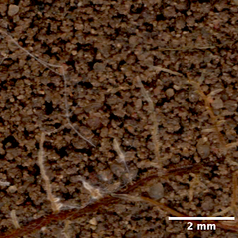<figcaption>Mycorhizes<em>champignons</em></figcaption></figure>
    </div>
  </div>

  <div class="sf-size">
    <h3>Mésofaune</h3>
    <p class="sf-range">taille intermédiaire · d'environ 0,1 à 2 mm</p>
    <p>Collemboles, acariens, symphyles, diploures et enchytréides.</p>
    <div class="sf-taxa">
      <figure class="sf-taxon">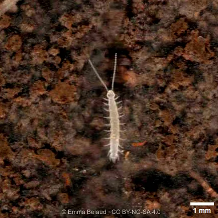<figcaption>Symphyla</figcaption></figure>
      <figure class="sf-taxon">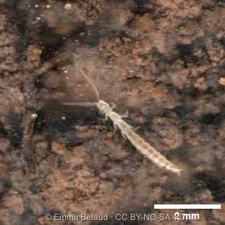<figcaption>Diplura</figcaption></figure>
      <figure class="sf-taxon">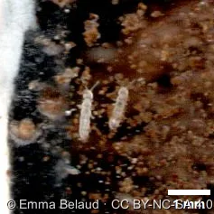<figcaption>Collembola<em>collemboles</em></figcaption></figure>
      <figure class="sf-taxon">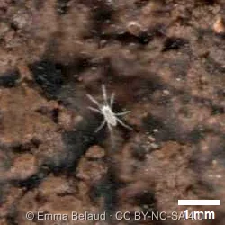<figcaption>Acari<em>acariens</em></figcaption></figure>
    </div>
  </div>

  <div class="sf-size">
    <h3>Macrofaune</h3>
    <p class="sf-range">les plus grands · plus de 2 mm</p>
    <p>Vers de terre, mille-pattes, cloportes, fourmis et araignées. Les racines des plantes ne sont pas des animaux, mais elles partagent aussi cet espace et attirent beaucoup de ces organismes.</p>
    <div class="sf-taxa">
      <figure class="sf-taxon">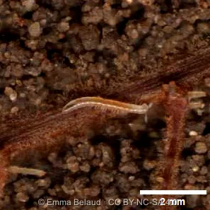<figcaption>Julida<em>iules</em></figcaption></figure>
      <figure class="sf-taxon">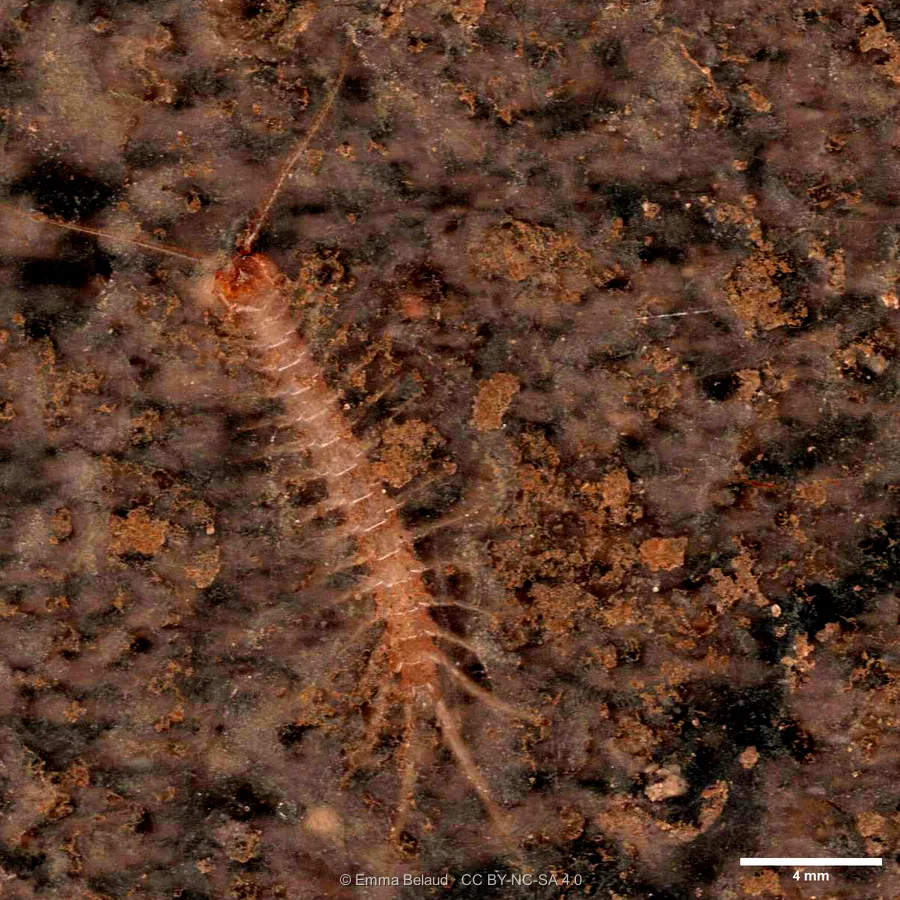<figcaption>Chilopoda<em>chilopodes</em></figcaption></figure>
      <figure class="sf-taxon">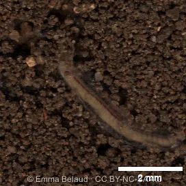<figcaption>Lumbricidae<em>vers de terre</em></figcaption></figure>
    </div>
  </div>

</div>
<p class="sf-credit">Photos © Emma Belaud · CC BY-NC-SA 4.0</p>
```

<!-- =========================================================================
     LES TROIS GROUPES FONCTIONNELS
     ========================================================================== -->

## Que font-ils là-dessous ?

Chaque organisme du sol joue un ou plusieurs rôles dans l'écosystème, que l'on appelle sa fonction. En regroupant les organismes par fonction, on obtient trois grands groupes fonctionnels : les **décomposeurs**, les **prédateurs** et les **ingénieurs de l'écosystème**. Les frontières sont floues, car de nombreuses espèces jouent plusieurs rôles à la fois.


<!-- ---------- Décomposeurs ---------- -->
:::: {.sf-band .sf-decomposers}
## Décomposeurs

::: {.sf-split}
::: sf-text
Les décomposeurs se nourrissent de plantes mortes, d'animaux morts et de leurs déjections, et transforment cette matière organique étape par étape : **ce sont les recycleurs du sol**. Les animaux du sol fragmentent et mélangent les débris, puis les micro-organismes terminent le travail par la minéralisation, qui réduit la matière en molécules simples. Ce sont ces nutriments que les plantes peuvent enfin utiliser pour grandir.
:::
```{=html}
<div>
  <video class="sf-video" muted loop playsinline preload="metadata" poster="../images/posters/leaf_decomposition.jpg" aria-label="Litière de feuilles décomposée par la vie du sol">
    <source src="../images/animation/leaf_decomposition.mp4" type="video/mp4">
  </video>
  <p class="sf-caption">Une feuille en cours de décomposition par un champignon, vue à travers le scanner.</p>
</div>
```
:::

```{=html}
<div class="sf-taxa">
  <figure class="sf-taxon">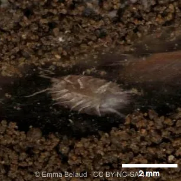<figcaption>Isopoda<em>cloportes</em></figcaption></figure>
  <figure class="sf-taxon">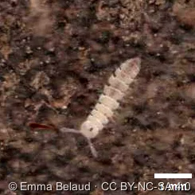<figcaption>Polydesmida<em>mille-pattes à dos plat</em></figcaption></figure>
  <figure class="sf-taxon"><figcaption>Julida<em>iules</em></figcaption></figure>
  <figure class="sf-taxon">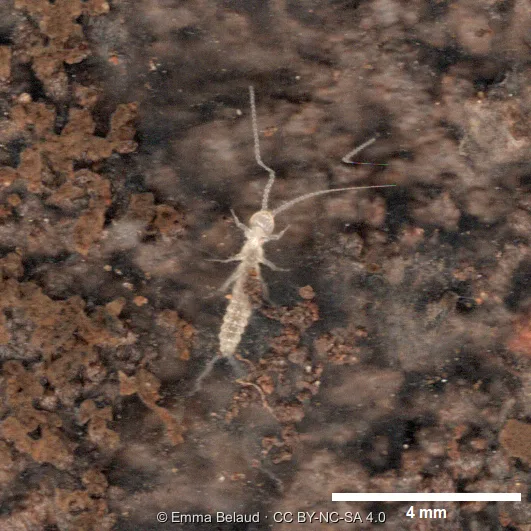<figcaption>Diplura</figcaption></figure>
  <figure class="sf-taxon"><figcaption>Collembola<em>collemboles</em></figcaption></figure>
</div>
<p class="sf-credit">Photos © Emma Belaud · CC BY-NC-SA 4.0</p>
```
::::

<!-- ---------- Prédateurs ---------- -->
:::: {.sf-band .sf-predators}
## Prédateurs

Les prédateurs se nourrissent d'autres organismes vivants, ce qui en fait des acteurs clés de la **régulation biologique**. En s'attaquant aux ravageurs des cultures par exemple, ils profitent directement à l'agriculture et sont appelés auxiliaires. Plus largement, en régulant les populations de proies, ils favorisent la coexistence de nombreuses espèces, ce qui soutient la biodiversité. 

```{=html}
<div>
  <video class="sf-video" muted loop playsinline preload="metadata" poster="../images/posters/geophilomorpha_grazing.jpg" aria-label="Un chilopode géophilomorphe qui circule autour d'une racine">
    <source src="../images/animation/geophilomorpha_grazing.mp4" type="video/mp4">
  </video>
  <p class="sf-caption">Un chilopode géophilomorphe qui rode autour d'une racine.</p>
</div>
```

```{=html}
<div class="sf-taxa">
  <figure class="sf-taxon">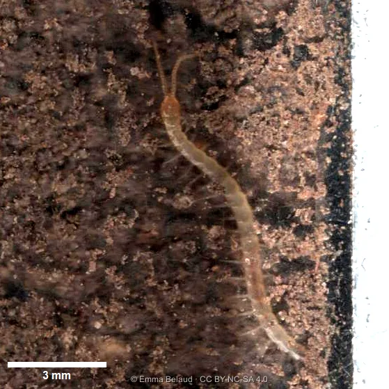<figcaption>Geophilomorpha<em>chilopodes</em></figcaption></figure>
  <figure class="sf-taxon"><figcaption>Chilopoda<em>chilopodes</em></figcaption></figure>
  <figure class="sf-taxon">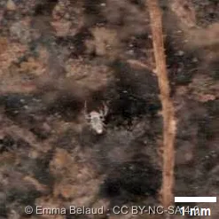<figcaption>Pseudoscorpionida</figcaption></figure>
  <figure class="sf-taxon"><figcaption>Acari<em>acariens</em></figcaption></figure>
  <figure class="sf-taxon"><figcaption>Diplura</figcaption></figure>
</div>
<p class="sf-credit">Photos © Emma Belaud · CC BY-NC-SA 4.0</p>
```
::::

<!-- ---------- Ingénieurs ---------- -->
:::: {.sf-band .sf-engineers}
## Ingénieurs

Les ingénieurs de l'écosystème **façonnent la structure du sol**. En se déplaçant à la recherche de nourriture ou d'un abri, ils creusent et déplacent de la matière, créant de nouveaux espaces qui modifient l'habitat de tous les autres organismes. Les vers de terre et les fourmis sont les ingénieurs les plus connus, mais en réalité tous les organismes du sol, même les plus petits, contribuent par leurs déplacement à mélanger le sol et à affiner sa structure.

```{=html}
<div>
  <video class="sf-video" muted loop playsinline preload="metadata" poster="../images/posters/ants_bioturbation.jpg" aria-label="Des fourmis qui creusent des galeries dans le sol">
    <source src="../images/animation/ants_bioturbation.mp4" type="video/mp4">
  </video>
  <p class="sf-caption">Des fourmis qui creusent des galeries.</p>
</div>
```

```{=html}
<div class="sf-taxa">
  <figure class="sf-taxon"><figcaption>Lumbricidae<em>vers de terre</em></figcaption></figure>
  <figure class="sf-taxon">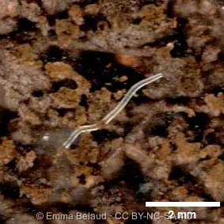<figcaption>Enchytraeidae<em>enchytréides</em></figcaption></figure>
  <figure class="sf-taxon">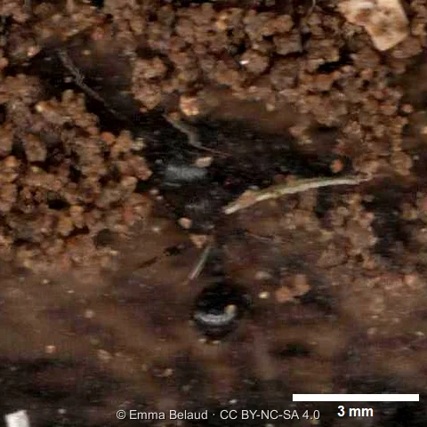<figcaption>Formicidae<em>fourmis</em></figcaption></figure>
</div>
<p class="sf-credit">Photos © Emma Belaud · CC BY-NC-SA 4.0</p>
```
::::

<!-- =========================================================================
     ZOOM SUR LA BIOTURBATION
     ========================================================================== -->
:::: {.sf-band .sf-bioturb}
## Zoom sur la bioturbation

Le réarrangement physique du sol par les organismes vivants porte un nom précis : la **bioturbation**. Les vers de terre sont largement connus pour cela. En creusant, ils créent des pores qui permettent à l'eau et à l'air de circuler et aux racines de pénétrer, comme le montre l'animation. 

Un sol bien structuré est composé de particules minérales et organiques assemblées en agrégats de tailles variées, séparés par des espaces vides (la porosité). 
```{=html}
<div>
  <video class="sf-video" muted loop playsinline preload="metadata" poster="../images/posters/earthworm_bioturbation.jpg" aria-label="Bioturbation par un ver de terre">
    <source src="../images/animation/earthworm_bioturbation.mp4" type="video/mp4">
  </video>
  <p class="sf-caption">Bioturbation par un ver de terre.</p>
</div>
```
::::

<!-- =========================================================================
     CHAMPIGNONS ET RACINES
     ========================================================================== -->

:::: {.sf-band .sf-red}
## Les champignons : des autoroutes souterraines

::: {.sf-split}
::: sf-text
Les champignons sont présents partout dans le sol. Ils le colonisent en développant un réseau de filaments appelés hyphes. Ce réseau fonctionne comme un vaste système de transport, qui achemine les nutriments sur de longues distances.
:::
```{=html}
<div>
  <video class="sf-video" muted loop playsinline preload="metadata" poster="../images/posters/fungi_colonization.jpg" aria-label="Des hyphes fongiques qui colonisent le sol">
    <source src="../images/animation/fungi_colonization.mp4" type="video/mp4">
  </video>
  <p class="sf-caption">Des hyphes fongiques qui colonisent le sol.</p>
</div>
```
:::

### Champignons et racines : un accord gagnant-gagnant

Certains de ces champignons forment un partenariat avec les racines des plantes, appelé **mycorhize**. C'est une **symbiose**, c'est-à-dire que les deux partenaires en tirent profit : la plante fournit au champignon des composés riches en carbone et, en retour, le champignon approvisionne la plante en nutriments et en eau, prolongeant de fait son système racinaire.
Les hyphes fongiques peuvent explorer un volume de sol environ 10 fois plus grand que celui des racines seules. Les plantes mycorhizées ont ainsi tendance à mieux pousser, à mieux supporter les conditions difficiles et à être mieux protégées contre les menaces extérieures.

```{=html}
<div>
  <video class="sf-video" muted loop playsinline preload="metadata" poster="../images/posters/mycorhization_ECM.jpg" aria-label="Extrémité de racine ectomycorhizée">
    <source src="../images/animation/mycorhization_ECM.mp4" type="video/mp4">
  </video>
  <p class="sf-caption">Ectomycorhizes (ECM) sur une racine.</p>
</div>
```
::::

:::: {.sf-band .sf-earth}
## Les fourmis et leurs troupeaux de pucerons

Les racines peuvent aussi être attaquées par des animaux du sol. Les pucerons des racines, par exemple, s'en nourrissent. Ils ont développé une relation de mutualisme avec les fourmis : celles-ci protègent les pucerons de leurs nombreux prédateurs et, en retour, se nourrissent du miellat sucré que les pucerons produisent. Lorsque ces populations deviennent trop denses, ce partenariat peut menacer les cultures.

```{=html}
<div>
  <video class="sf-video" muted loop playsinline preload="metadata" poster="../images/posters/mutualism_aphids_ants.jpg" aria-label="Des fourmis qui s'occupent de pucerons sur une racine">
    <source src="../images/animation/mutualism_aphids_ants.mp4" type="video/mp4">
  </video>
  <p class="sf-caption">Des fourmis qui s'occupent de pucerons sur une racine.</p>
</div>
```
::::

:::: {.sf-band .sf-brown}
## Quand le broutage aide les racines à pousser

Le broutage des racines par les animaux du sol n'est pas toujours une mauvaise nouvelle pour les cultures. Lorsque des herbivores stoppent la croissance de la racine principale, la plante peut réagir en produisant des racines latérales. Cela augmente la surface de contact entre les racines et le sol, et donc la capacité de la plante à absorber les nutriments. Ces racines plus fines, à croissance plus lente, sont aussi celles qui sont le plus facilement colonisées par les champignons mycorhiziens, ce qui nous ramène au partenariat décrit plus haut.

```{=html}
<div>
  <video class="sf-video" muted loop playsinline preload="metadata" poster="../images/posters/mycorhization_finebranchedroot.jpg" aria-label="Mycorhization d'une racine fine et ramifiée">
    <source src="../images/animation/mycorhization_finebranchedroot.mp4" type="video/mp4">
  </video>
  <p class="sf-caption">Mycorhization d'une racine fine et ramifiée.</p>
</div>
```
::::

:::: {.sf-band .sf-plum}
## Birth-day

La vie du sol commence elle aussi sous terre. La séquence ci-dessous montre l'éclosion d'œufs de Julida. Les mille-pattes tout juste éclos n'ont que quelques paires de pattes et gagnent des segments à chaque mue.

```{=html}
<div>
  <video class="sf-video" muted loop playsinline preload="metadata" poster="../images/posters/hatching_myriapoda.jpg" aria-label="Éclosion d'œufs de mille-pattes Julida.">
    <source src="../images/animation/hatching_myriapoda.mp4" type="video/mp4">
  </video>
  <p class="sf-caption">Éclosion d'œufs de mille-pattes Julida.</p>
</div>
```
::::

:::: {.sf-band .sf-olive}
## La vie du sol face aux conditions difficiles ?

La vie dans le sol peut aussi affronter des conditions difficiles. Comme les mammifères hibernants, mieux connus, les animaux du sol peuvent ralentir leur activité en hiver et attendre des jours meilleurs, un état appelé dormance. L'animation ci-dessous montre un ver de terre resté en dormance pendant un mois en hiver :

```{=html}
<div>
  <video class="sf-video" muted loop playsinline preload="metadata" poster="../images/posters/earthworm_dormancy.jpg" aria-label="Un ver de terre qui entre en dormance">
    <source src="../images/animation/earthworm_dormancy.mp4" type="video/mp4">
  </video>
  <p class="sf-caption">Un ver de terre qui entre en dormance.</p>
</div>
```
:::: 


<!--:::: {.sf-band .sf-raspberry}

 =========================================================================
     SCRIPT : lance une vidéo quand elle est visible, la met en pause sinon.
     - Si le visiteur a demandé « moins d'animations » (réglage système), ou si
       le navigateur refuse de lancer la lecture seul (cas fréquent sur
       téléphone : mode économie d'énergie d'iOS, économiseur de données),
       la vidéo reçoit des boutons de lecture : on la lance alors d'un appui.
     - « muted » est aussi imposé par le script : certains navigateurs mobiles
       ignorent l'attribut HTML et bloquent alors la lecture automatique.
     ========================================================================== -->

```{=html}
<script>
(function () {
  var vids = Array.prototype.slice.call(document.querySelectorAll("video.sf-video"));
  var calm = window.matchMedia("(prefers-reduced-motion: reduce)").matches;
  vids.forEach(function (v) { v.muted = true; v.defaultMuted = true; });
  if (calm || !("IntersectionObserver" in window)) {
    vids.forEach(function (v) { v.controls = true; });
    return;
  }
  var io = new IntersectionObserver(function (entries) {
    entries.forEach(function (e) {
      var v = e.target;
      if (e.isIntersecting) {
        var p = v.play();
        // lecture refusée par le navigateur : on affiche les commandes
        if (p && p.catch) { p.catch(function () { v.controls = true; }); }
      } else { v.pause(); }
    });
  }, { threshold: 0.25 });
  vids.forEach(function (v) { io.observe(v); });
})();
</script>
```
