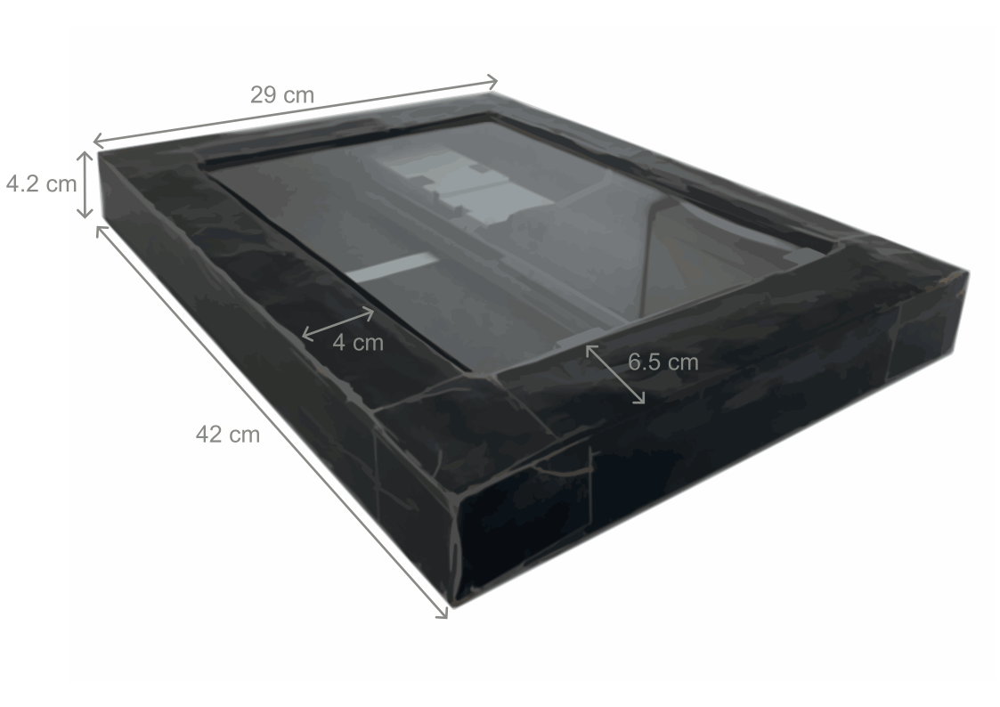
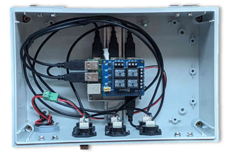

## Context

Soil is a major reservoir of biodiversity, hosting more than a quarter of all terrestrial biodiversity. Yet its opacity and the cryptic nature of the organisms living in it make it an especially difficult environment to study. To address this challenge, we developed an innovative method to monitor soil activity *in situ* by imaging.

## The device

The system relies on desktop flatbed scanners, adapted to field conditions and buried in the soil. In the field, each scanner is paired with an automated control module based on a Raspberry Pi, which handles image acquisition. This setup allows long-term, high-resolution acquisition campaigns with minimal human intervention.

::: {layout-ncol=2}

:::

:::: key-facts

::: fact
[6 h]{.fact-value}
[between two images]{.fact-label}
:::

::: fact
[1200 dpi]{.fact-value}
[image resolution]{.fact-label}
:::

::: fact
[A4]{.fact-value}
[scanned surface]{.fact-label}
:::

::: fact
[> 1 mm]{.fact-value}
[size of monitored organisms]{.fact-label}
:::

::::

## What the images reveal

Images are acquired every six hours at 1200 dpi over an A4 surface. This makes it possible to monitor the activity of organisms larger than one millimetre, including root structures, some fungal structures and many invertebrate taxa. It also allows their dynamics to be followed at a fine temporal scale and over long periods.

:::: video-grid

::: card-block
[Roots and fungi]{.block-label}



Colonization of oak roots by ectomycorrhizal (ECM) fungi observed by *in situ* imaging.
:::

::: card-block
[Invertebrates]{.block-label}



Mutualism between aphids and ants on roots observed by *in situ* imaging.
:::

::: card-block
[Roots and fauna]{.block-label}



Grazing and reiteration of an oak root observed by *in situ* imaging.
:::

::::

## From images to data

High-frequency automated monitoring generates a volume of data that quickly makes manual expertise incompatible with the available human and time resources. Generalizing imaging approaches, and more broadly moving towards soil ecology at large scale, therefore requires automated analysis pipelines able to process large image streams while maintaining an inference quality comparable to that of a human expert. We work on the design of such pipelines.

:::: card-grid

::: {.card-block .pipeline-card}
[]{.card-icon} [Roots]{.block-label}

### Root structures

To extract biological information on root structures, we use **RootPainter**, a deep-learning-based tool developed at the University of Copenhagen. It requires a training phase for the model.

[Associated publication ](https://doi.org/10.1111/nph.18387){.accent-link}



The RootPainter annotation interface.
:::

::: {.card-block .pipeline-card}
[]{.card-icon} [Invertebrates]{.block-label}

### Soil invertebrates

For invertebrates, we developed our own tool, based on two steps: animal **detection**, using heuristic methods that differentiate successive images, and **classification**, using a deep-learning model. A Shiny interface was developed to train the model.

[Associated publication ](https://doi.org/10.64898/2026.06.16.732537){.accent-link}



The Shiny interface used to annotate invertebrates and train the model.
:::

::::

## Related publications

- Belaud, E., Jourdan, C., Capowiez, Y., Hedde, M. (2026). Hearing and seeing through the soils: insights from new sensing technologies to monitor soil invertebrate activity. *Plant and Soil*. [doi](https://doi.org/10.1007/s11104-026-08694-2)
- Belaud, E., Jourdan, C., Barry-Etienne, D., Marsden, C., Robin, A., Taschen, E., Hedde, M. (2024). In situ soil imaging, a tool for monitoring the hourly to monthly temporal dynamics of soil biota. *Biology and Fertility of Soils*, 60, 1055–1071. [doi](https://doi.org/10.1007/s00374-024-01851-8)
- Pruvost, E., et al. (2022). Invertebrates Detection With YOLOv5: Towards Study of Soil Organisms Using Deep Learning. *IEEE*. [doi](http://dx.doi.org/10.1109/EUVIP53989.2022.9922675)

See the full list on the [Publications](publications.qmd) page, and more material in [Related resources](resources.qmd).