<!--
  PAGE SOIL FAUNA : mode d'emploi
  Les styles sont dans styles.css, section 16 (code couleur et syntaxe).
  - Le titre (bandeau vert en haut) vient de l'en-tête ci-dessus, comme sur
    les autres pages : title = accroche, subtitle = ligne d'explication.
  - Les parties « claires » sont du texte normal (## titre, paragraphes).
  - Chaque grand bandeau coloré est un bloc  :::: {.sf-band .sf-XXXX}
    XXXX = decomposers (ocre), predators (terre cuite), engineers (teal),
    green (vert), earth (brun). Il se termine par  ::::
  - Photos : images/photos_animals/ ; animations : images/animation/
    (dossiers créés par la conversion .tif -> .webp et .avi -> .mp4).
  - Ajouter un animal : copier une ligne <figure class="sf-taxon">...</figure>.
  - Changer de vidéo : changer seulement le nom du .mp4 dans src="...".
  - Mention de licence : <span class="sf-credit"> dans les légendes,
    <p class="sf-credit"> sous les planches de photos (voir reuse.qmd).
-->

## A hidden reservoir of biodiversity

Soil hosts almost a **quarter of all the species described on Earth** (Anthony et al., 2023). 
This largely hidden life **keeps ecosystems running** and supports services we all depend on, from food production to carbon storage. To make the most of these services, we need to understand the biological processes behind them.

Yet we still know surprisingly little about how soil life works. Soil has been considered as one of the **last biotic frontiers**, along with the deep ocean and the forest canopy (André et al., 1994). One reason is that soil is opaque, and its inhabitants are small and hard to reach. However, there is also a general lack of awareness and consideration regarding this hidden life.

Optical imagery sensors provide a great perspective for observing soil life in situ over time. On this page, you will find animations captured by automated optical scanners buried in the soil, allowing us to observe the cryptic life within the soil without disturbing it (learn more on the [Soil biodiversity imaging](soil_biodiversity_imaging.qmd) page).

## Who lives in the soil?

Soil organisms are highly diverse, and this diversity is particularly expressed in terms of size. They range from a few micrometers to several centimeters. Thus, it is common to present them according to their order of magnitude.

```{=html}
<div class="sf-sizes">

  <div class="sf-size">
    <h3>Microorganisms and microfauna</h3>
    <p class="sf-range">the smallest · under 0.1 mm</p>
    <p>Bacteria, archaea, fungi and protists, together with microscopic animals such as nematodes and tardigrades.</p>
    <div class="sf-taxa">
      <figure class="sf-taxon">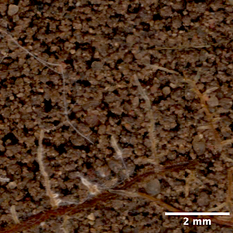<figcaption>Mycorrhizae<em>fungi</em></figcaption></figure>
    </div>
  </div>

  <div class="sf-size">
    <h3>Mesofauna</h3>
    <p class="sf-range">intermediate size · about 0.1 to 2 mm</p>
    <p>Springtails, mites, symphylans, diplurans and potworms.</p>
    <div class="sf-taxa">
      <figure class="sf-taxon">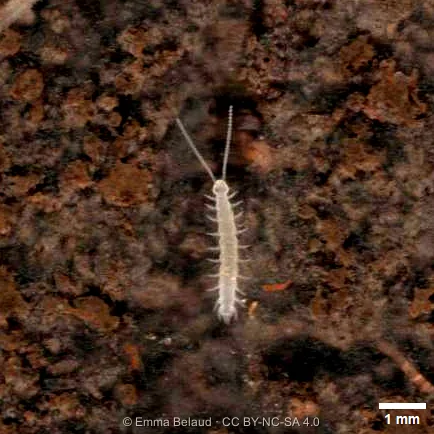<figcaption>Symphyla</figcaption></figure>
      <figure class="sf-taxon">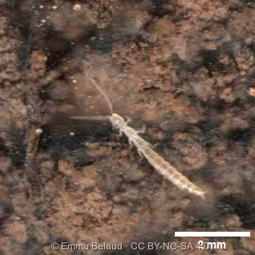<figcaption>Diplura</figcaption></figure>
      <figure class="sf-taxon">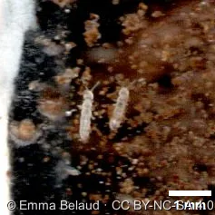<figcaption>Collembola<em>springtails</em></figcaption></figure>
      <figure class="sf-taxon">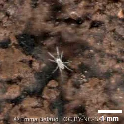<figcaption>Acari<em>mites</em></figcaption></figure>
    </div>
  </div>

  <div class="sf-size">
    <h3>Macrofauna</h3>
    <p class="sf-range">the largest · over 2 mm</p>
    <p>Earthworms, millipedes, woodlice, ants and spiders. Plant roots are not animals, but they also share this space and attract many of these organisms.</p>
    <div class="sf-taxa">
      <figure class="sf-taxon">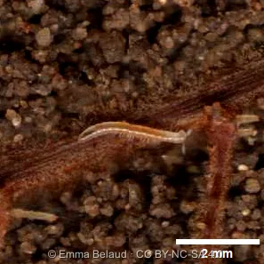<figcaption>Julida<em>millipedes</em></figcaption></figure>
      <figure class="sf-taxon">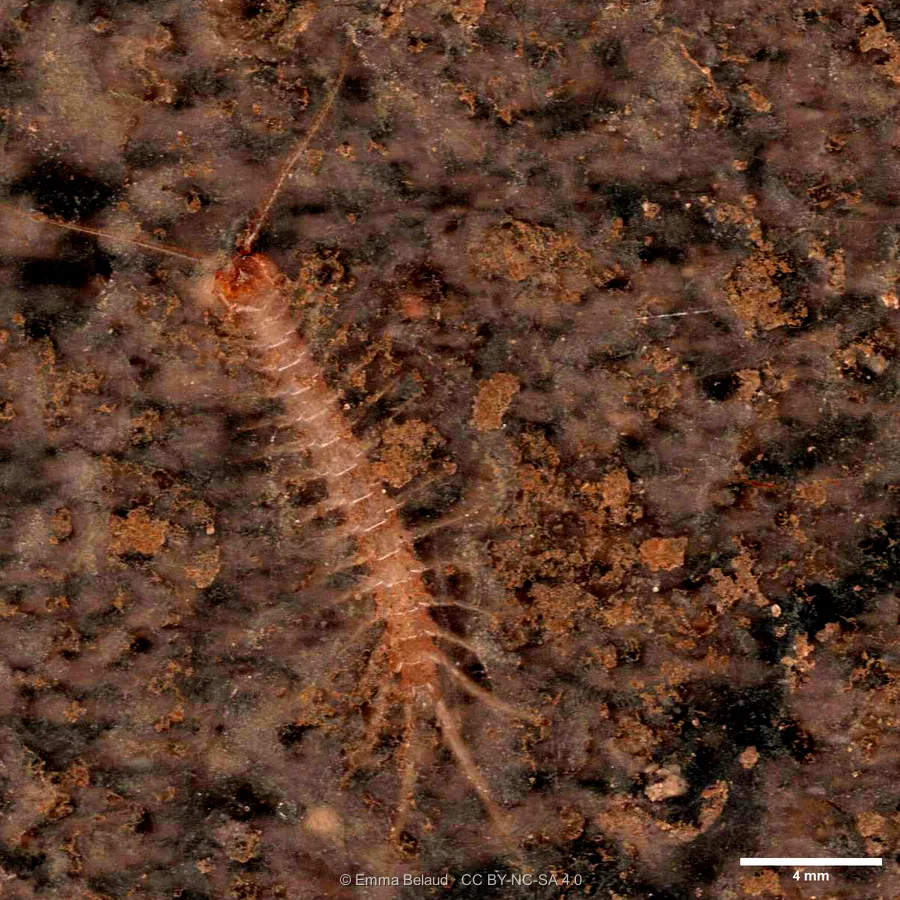<figcaption>Chilopoda<em>centipedes</em></figcaption></figure>
      <figure class="sf-taxon">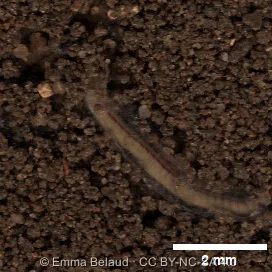<figcaption>Lumbricidae<em>earthworms</em></figcaption></figure>
    </div>
  </div>

</div>
<p class="sf-credit">Photos © Emma Belaud · CC BY-NC-SA 4.0</p>
```

<!-- =========================================================================
     LES TROIS GROUPES FONCTIONNELS
     ========================================================================== -->

## What do they do down there?

Each soil organism plays one or several roles in the ecosystem, which we call its function. Grouping organisms by function gives three main functional groups: **decomposers**, **predators** and **ecosystem engineers**. The boundaries are blurry, because many species play several roles at once.


<!-- ---------- Décomposeurs ---------- -->
:::: {.sf-band .sf-decomposers}
## Decomposers

::: {.sf-split}
::: sf-text
Decomposers feed on dead plants, dead animals and their droppings, and transform this organic matter step by step: **they are the recyclers of the soil**. Decomposition is actually a succession of transformations of matter, whose ultimate stage is mineralization—meaning the conversion of matter into simple molecules, or nutrients. These are the nutrients that plants can finally use to grow.

:::
```{=html}
<div>
  <video class="sf-video" muted loop playsinline preload="metadata" poster="images/posters/leaf_decomposition.jpg" aria-label="Leaf litter being decomposed by soil life">
    <source src="images/animation/leaf_decomposition.mp4" type="video/mp4">
  </video>
  <p class="sf-caption">A leaf being broken down, seen through the scanner.</p>
</div>
```
:::

```{=html}
<div class="sf-taxa">
  <figure class="sf-taxon">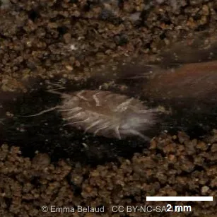<figcaption>Isopoda<em>woodlice</em></figcaption></figure>
  <figure class="sf-taxon">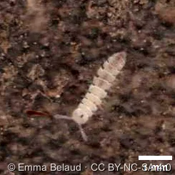<figcaption>Polydesmida<em>flat-backed millipedes</em></figcaption></figure>
  <figure class="sf-taxon"><figcaption>Julida<em>millipedes</em></figcaption></figure>
  <figure class="sf-taxon">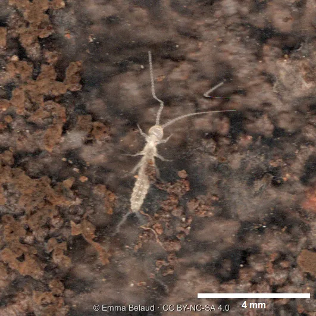<figcaption>Diplura</figcaption></figure>
  <figure class="sf-taxon"><figcaption>Collembola<em>springtails</em></figcaption></figure>
</div>
<p class="sf-credit">Photos © Emma Belaud · CC BY-NC-SA 4.0</p>
```
::::

<!-- ---------- Prédateurs ---------- -->
:::: {.sf-band .sf-predators}
## Predators

Predators eat other living organisms, which makes them key players in **biological regulation**. By feeding on crop pests, they directly benefit agriculture and are called beneficial organisms. More broadly, by keeping prey populations in check, they can help many species live side by side (coexistence), which supports biodiversity. 

```{=html}
<div>
  <video class="sf-video" muted loop playsinline preload="metadata" poster="images/posters/geophilomorpha_grazing.jpg" aria-label="A geophilomorph centipede roaming around a root">
    <source src="images/animation/geophilomorpha_grazing.mp4" type="video/mp4">
  </video>
  <p class="sf-caption">A geophilomorph centipede roaming around a root.</p>
</div>
```

```{=html}
<div class="sf-taxa">
  <figure class="sf-taxon">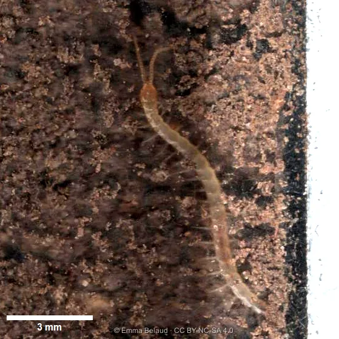<figcaption>Geophilomorpha<em>centipedes</em></figcaption></figure>
  <figure class="sf-taxon"><figcaption>Chilopoda<em>centipedes</em></figcaption></figure>
  <figure class="sf-taxon">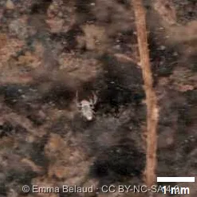<figcaption>Pseudoscorpionida</figcaption></figure>
  <figure class="sf-taxon"><figcaption>Acari<em>mites</em></figcaption></figure>
  <figure class="sf-taxon"><figcaption>Diplura</figcaption></figure>
</div>
<p class="sf-credit">Photos © Emma Belaud · CC BY-NC-SA 4.0</p>
```
::::

<!-- ---------- Ingénieurs ---------- -->
:::: {.sf-band .sf-engineers}
## Engineers

Ecosystem engineers **shape the structure of the soil**. As they move about in search of food or shelter, they dig and push material around, creating new spaces that change the habitat of all the other organisms. Earthworms and ants are the best-known engineers, but in reality every soil organism, even the smallest, contributes to mixing the soil and refining its structure.

```{=html}
<div>
  <video class="sf-video" muted loop playsinline preload="metadata" poster="images/posters/ants_bioturbation.jpg" aria-label="Ants digging galleries in the soil">
    <source src="images/animation/ants_bioturbation.mp4" type="video/mp4">
  </video>
  <p class="sf-caption">Ants digging galleries.</p>
</div>
```

```{=html}
<div class="sf-taxa">
  <figure class="sf-taxon"><figcaption>Lumbricidae<em>earthworms</em></figcaption></figure>
  <figure class="sf-taxon">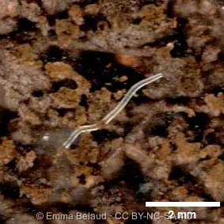<figcaption>Enchytraeidae<em>potworms</em></figcaption></figure>
  <figure class="sf-taxon">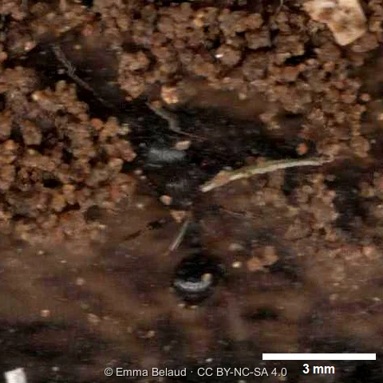<figcaption>Formicidae<em>ants</em></figcaption></figure>
</div>
<p class="sf-credit">Photos © Emma Belaud · CC BY-NC-SA 4.0</p>
```
::::

<!-- =========================================================================
     ZOOM SUR LA BIOTURBATION
     ========================================================================== -->
:::: {.sf-band .sf-bioturb}
## Zoom on bioturbation

The physical rearrangement of soil by living organisms has a specific name: **bioturbation**. Earthworms are widely known for it. Their burrowing creates pores that let water and air circulate and roots penetrate, as the animation shows.

A well-structured soil is made of mineral and organic particles assembled into aggregates of various sizes, with empty spaces in between (the porosity).
```{=html}
<div>
  <video class="sf-video" muted loop playsinline preload="metadata" poster="images/posters/earthworm_bioturbation.jpg" aria-label="Bioturbation by an earthworm">
    <source src="images/animation/earthworm_bioturbation.mp4" type="video/mp4">
  </video>
  <p class="sf-caption">Bioturbation by an earthworm.</p>
</div>
```
::::
<!-- =========================================================================
     CHAMPIGNONS ET RACINES
     ========================================================================== -->

:::: {.sf-band .sf-red}
## Fungi, underground highways

::: {.sf-split}
::: sf-text
Fungi can be found everywhere in the soil. They colonise it by growing a network of thread-like filaments called hyphae. This network works as an extensive transport system, carrying nutrients over long distances.
:::
```{=html}
<div>
  <video class="sf-video" muted loop playsinline preload="metadata" poster="images/posters/fungi_colonization.jpg" aria-label="Fungal hyphae colonising the soil">
    <source src="images/animation/fungi_colonization.mp4" type="video/mp4">
  </video>
  <p class="sf-caption">Fungal hyphae colonising the soil.</p>
</div>
```
:::

### Fungi and roots: a deal that pays both ways

Some of these fungi form a partnership with plant roots, called **mycorrhiza**. It is a **symbiosis**, meaning both sides benefit: the plant gives the fungus carbon-rich compounds, and in return the fungus supplies the plant with nutrients and water, effectively extending its root system.
Fungal hyphae can explore a volume of soil about 10 times larger than roots alone. As a result, mycorrhizal plants tend to grow better, cope better with harsh conditions and be better protected against external threats.

```{=html}
<div>
  <video class="sf-video" muted loop playsinline preload="metadata" poster="images/posters/mycorhization_ECM.jpg" aria-label="Ectomycorrhizal root tip">
    <source src="images/animation/mycorhization_ECM.mp4" type="video/mp4">
  </video>
  <p class="sf-caption">Ectomycorrhizae (ECM) on a root.</p>
</div>
```
::::

:::: {.sf-band .sf-earth}
## Roots, an attractive resource

Whether dead or alive, roots are a resource for a multitude of organisms. These organisms in turn become prey for other communities of species and, through their various activities, alter the conditions of the surrounding soil, often making it highly attractive to other belowground dwellers. Roots thus form a true *hotspot* of activity at the heart of the soil matrix.

In the sequence below, a voracious insect larva makes short work of a root.

```{=html}
<div>
  <video class="sf-video" muted loop playsinline preload="metadata" poster="../images/posters/insecta_larva_grazing.jpg" aria-label="An insect larva grazing on a root">
    <source src="../images/animation/insecta_larva_grazing.mp4" type="video/mp4">
  </video>
  <p class="sf-caption">An insect larva grazing on a root.</p>
</div>
```


### Ants and their herds of aphids

Some animals have developed close relationships to make the most of available resources. Root aphids feed on roots but, being vulnerable to predators, have teamed up with ants in a mutualistic relationship: the ants protect them and, in return, feed on the sugary honeydew they produce. When these populations become too dense, however, this partnership can threaten crops.

```{=html}
<div>
  <video class="sf-video" muted loop playsinline preload="metadata" poster="../images/posters/mutualism_aphids_ants.jpg" aria-label="Ants tending aphids on a root">
    <source src="../images/animation/mutualism_aphids_ants.mp4" type="video/mp4">
  </video>
  <p class="sf-caption">Ants tending aphids on a root.</p>
</div>
```

### Grazing stimulates branching

Grazing is not always detrimental: the mechanisms at play are more complex than they seem, and each individual event is part of a broader ecological balance.

One example of this is the ecological dynamic observed in truffle orchards, where the outcome the human operator is aiming for is truffle production. In the sequence below, when herbivores halt the growth of the taproot, the plant responds by producing lateral roots. This increases the contact surface between roots and soil, and therefore the plant's capacity to absorb nutrients. These finer, slower-growing roots are also the ones most easily colonized by mycorrhizal fungi. Here, they can be recognized by the whitish structures appearing along the root: these are mycorrhizae, another form of mutualism in the soil, like the one described above.

```{=html}
<div>
  <video class="sf-video" muted loop playsinline preload="metadata" poster="../images/posters/mycorhization_finebranchedroot.jpg" aria-label="Mycorrhization of a fine, branched root">
    <source src="../images/animation/mycorhization_finebranchedroot.mp4" type="video/mp4">
  </video>
  <p class="sf-caption">Mycorrhization of a fine, branched root.</p>
</div>
```
::::

:::: {.sf-band .sf-plum}
## Birth-day

Soil life also begins underground. Each group of organisms has its own reproductive modes and cycles.

Imaging has allowed us to observe, opportunistically, moments as discreet as the egg-laying and hatching of juilda (millipedes), as shown in the sequence below. This animation follows the development of the eggs, from laying to the hatching of young millipedes. At birth, they possess only a limited number of segments and legs, which they gradually acquire through successive molts.

```{=html}
<div>
  <video class="sf-video" muted loop playsinline preload="metadata" poster="images/posters/hatching_myriapoda.jpg" aria-label="Julida millipede eggs hatching.">
    <source src="images/animation/hatching_myriapoda.mp4" type="video/mp4">
  </video>
  <p class="sf-caption">Julida millipede eggs hatching.</p>
</div>
```
::::

:::: {.sf-band .sf-olive}
## Life in slow motion

In rhythm with the seasons and environmental fluctuations, the soil is constantly changing. Faced with sometimes harsh conditions, its inhabitants deploy strategies to survive.

Earthworms, for example, are extremely dependent on soil moisture. They shift to a slowed-down lifestyle when the soil dries out. To prevent desiccation, they coil their bodies into a tight knot to minimize their exposed surface area, then isolate themselves in a small chamber lined with their own mucus, thereby creating a more humid micro-refuge.

This mechanism can be observed in the animation below, which follows an earthworm throughout the month of March.

```{=html}
<div>
  <video class="sf-video" muted loop playsinline preload="metadata" poster="images/posters/earthworm_dormancy.jpg" aria-label="An earthworm entering dormancy">
    <source src="images/animation/earthworm_dormancy.mp4" type="video/mp4">
  </video>
  <p class="sf-caption">An earthworm entering dormancy.</p>
</div>
```
:::: 


<!--:::: {.sf-band .sf-raspberry}

 =========================================================================
     SCRIPT : lance une vidéo quand elle est visible, la met en pause sinon.
     - Si le visiteur a demandé « moins d'animations » (réglage système), ou si
       le navigateur refuse de lancer la lecture seul (cas fréquent sur
       téléphone : mode économie d'énergie d'iOS, économiseur de données),
       la vidéo reçoit des boutons de lecture : on la lance alors d'un appui.
     - « muted » est aussi imposé par le script : certains navigateurs mobiles
       ignorent l'attribut HTML et bloquent alors la lecture automatique.
     ========================================================================== -->

```{=html}
<script>
(function () {
  var vids = Array.prototype.slice.call(document.querySelectorAll("video.sf-video"));
  var calm = window.matchMedia("(prefers-reduced-motion: reduce)").matches;
  vids.forEach(function (v) { v.muted = true; v.defaultMuted = true; });
  if (calm || !("IntersectionObserver" in window)) {
    vids.forEach(function (v) { v.controls = true; });
    return;
  }
  var io = new IntersectionObserver(function (entries) {
    entries.forEach(function (e) {
      var v = e.target;
      if (e.isIntersecting) {
        var p = v.play();
        // lecture refusée par le navigateur : on affiche les commandes
        if (p && p.catch) { p.catch(function () { v.controls = true; }); }
      } else { v.pause(); }
    });
  }, { threshold: 0.25 });
  vids.forEach(function (v) { io.observe(v); });
})();
</script>
```
